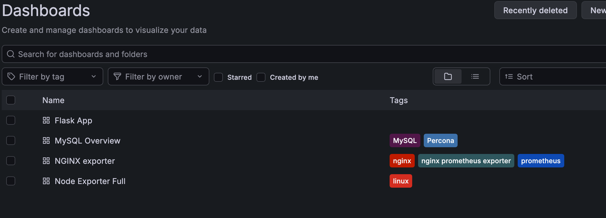

Prometheus实验

Prometheus 是「时序数据库 + 拉取式采集引擎」，它自己不主动去抓指标，而是约定：被监控的服务 / 组件，暴露一个 `/metrics` HTTP 接口，输出纯文本格式指标；Prometheus 周期性（我们配置的 15s）去 GET 这个接口，把数据拉回来存起来，之后用 PromQL 查询、Grafana 画图、配置告警。

```
[被监控对象] → [Exporter] → 暴露 /metrics → Prometheus 定时拉取 → 存储时序数据 → Grafana 查询绘图
```
## 1. 什么是 Exporter？为什么需要它？

很多原生软件**本身不自带 /metrics 接口**：

- Linux 操作系统本身（内核、CPU、磁盘）没有 metrics 接口
- MySQL 本身没有 metrics 接口
- Nginx 默认也没有 metrics 接口

👉 **Exporter = 适配器 / 翻译器**
它做一件事：**内部去读原程序的状态（读文件、读命令、连数据库），翻译成 Prometheus 标准文本指标格式，开一个 HTTP 端口暴露 `/metrics`**

## 2. Prometheus 核心配置

```
scrape_configs:
  - job_name: "node"
    static_configs:
      - targets: ["node-exporter:9100"]
```

含义：

- `job_name`：分组名字，标记一类监控目标
- `targets`：**要拉取的地址列表**，也就是 exporter 的 `/metrics` 地址
- 默认 `scrape_interval:15s`：每 15 秒，Prometheus 发起一次 HTTP GET `/metrics`
- 拿到数据后，自动打上标签 `job="node", instance="xxx"`，存入时序库

> 重点：Prometheus **不托管 exporter 的生命周期**！
> Exporter 是独立进程，挂了就不再暴露指标 → Prometheus 拉取失败 → target 变成 DOWN。

## 3. 指标基础概念（Prometheus 数据模型）

一条时序数据 = `指标名{标签key=标签value} 值 @ 时间戳`
示例：

```
node_cpu_seconds_total{cpu="0",mode="user"} 1234.5 1761902105
```
## 4. Pull 模型的优缺点

✅ 优点

1. 简单：被监控端只需要暴露 HTTP 接口，不需要知道 Prometheus 地址；Prometheus 挂了，exporter 照常工作
2. 去中心化：只要网络通，Prometheus 去拉；适合云、K8s 动态发现（自动发现 target）
3. 容易排查：你可以浏览器直接访问 `:9100/metrics`，先确认指标有没有输出，和你刚才排查问题的方式一致

❌ 缺点

1. 网络不通、被监控端在 NAT 后面（内网机器出不去），Prometheus 拉不到 → 这时要用 Pushgateway（临时推送，任务类监控，不推荐长期用）
2. 拉取间隔固定，很难做到毫秒级采集

> 
> 对比 Push：比如日志采集 Filebeat，是主动把日志推给后端；Prometheus 反过来。
## 5. Grafana 在整个链路里是什么角色？

Grafana **不存数据，不采集指标**，它只是一个可视化面板前端：

- 配置一个 Prometheus 数据源
- 写 PromQL 查询语句
- 渲染折线图、饼图、表格；配置告警通知（短信 / 钉钉 / 邮件）

数据流：
`Exporter → Prometheus（存时序） ← Grafana（查询绘图）`

## 6. 告警链路（扩展，你后面会接触）

Prometheus 自带 Alert Rules（告警规则），计算 PromQL 表达式，满足条件后把告警发给 **Alertmanager**，由 Alertmanager 负责分组、降噪、去重、发通知。

> 
> Grafana 也能做简单告警，但生产标准方案是 Prometheus Rule + Alertmanager


## 7. 实验

### 架构图

```
用户 → Nginx(反向代理) → Flask业务应用（自带 /metrics） → MySQL
          ↓                    ↓                    ↓
    nginx-exporter        业务埋点指标          mysqld-exporter
          ↓
    node-exporter（机器指标）    ↓                 ↓   
          ↘
           Prometheus（统一Pull、本地时序存储、告警规则）
                             ↓
                       Grafana（可视化大盘）

```

### 部署
我们用docker-compose来完成整个部署，可参见[docker-compose.yaml](docker-compose.yaml)。

```shell
NAME                    IMAGE                                    COMMAND                   SERVICE           CREATED         STATUS         PORTS
mysqld-exporter         prom/mysqld-exporter:v0.15.1             "/bin/mysqld_exporte…"   mysqld-exporter   6 seconds ago   Up 5 seconds   0.0.0.0:9104->9104/tcp, [::]:9104->9104/tcp
prom-flask-app-1        prom-flask-app                           "python app.py"           flask-app         6 seconds ago   Up 5 seconds   0.0.0.0:5005->5000/tcp, [::]:5005->5000/tcp
prom-grafana-1          grafana/grafana:latest                   "/run.sh"                 grafana           6 seconds ago   Up 5 seconds   0.0.0.0:3000->3000/tcp, [::]:3000->3000/tcp
prom-mysql-1            mysql:8.0                                "docker-entrypoint.s…"   mysql             6 seconds ago   Up 5 seconds   0.0.0.0:3306->3306/tcp, [::]:3306->3306/tcp
prom-nginx-1            nginx:alpine                             "/docker-entrypoint.…"   nginx             6 seconds ago   Up 5 seconds   0.0.0.0:8080->80/tcp, [::]:8080->80/tcp
prom-nginx-exporter-1   nginx/nginx-prometheus-exporter:latest   "/usr/bin/nginx-prom…"   nginx-exporter    6 seconds ago   Up 5 seconds   0.0.0.0:9113->9113/tcp, [::]:9113->9113/tcp
prom-node-exporter-1    prom/node-exporter:latest                "/bin/node_exporter …"   node-exporter     6 seconds ago   Up 5 seconds   0.0.0.0:9100->9100/tcp, [::]:9100->9100/tcp
prom-prometheus-1       prom/prometheus:latest                   "/bin/prometheus --c…"   prometheus        6 seconds ago   Up 5 seconds   0.0.0.0:9090->9090/tcp, [::]:9090->9090/tcp
```
### 验证

1. 验证 targets 是否被 Prometheus 正常抓取
    
    访问`http://127.0.0.1:9090/targets`看是否全部是`UP`

2. 验证业务链路

- 走 Nginx 访问：[http://127.0.0.1:8080](http://127.0.0.1:8080) → 应该返回 `Hello from our custom Flask App! ✅`
- 直接访问 flask（绕过代理）：[http://127.0.0.1:5005](http://127.0.0.1:5005)
- 访问错误接口造错误指标：[http://127.0.0.1:8080/error](http://127.0.0.1:8080/error)
- 直接看 flask 原始指标：[http://127.0.0.1:5005/metrics](http://127.0.0.1:5005/metrics)

造持续流量，方便后面看曲线：
```
while true;do curl http://127.0.0.1:8080; curl http://127.0.0.1:8080/error;sleep 0.4;done
```

3. 尝试promql

```promQL
# Flask 业务指标
# 每秒请求速率
rate(app_http_requests_total[1m])
# 错误速率
rate(app_http_errors_total[1m])
# 当前正在处理的请求
app_http_in_flight_requests
# Nginx 指标（nginx-exporter
# nginx总请求
nginx_http_requests_total
# mysql连接数
mysql_global_status_threads_connected
# CPU使用率
100 - (avg by (instance) (irate(node_cpu_seconds_total{mode="idle"}[1m])) * 100)
```

4. Grafana 接入

地址：[http://127.0.0.1:3000](http://127.0.0.1:3000)
账号：`admin`，密码：`admin123`

1. 配置数据源：`Connections → Data sources → Add data source → Prometheus`
2. URL 填：`http://prometheus:9090`
3. 点 Save & test，提示成功

然后两条路线二选一：
A. 导入现成 Dashboard：

- Node Exporter：ID `1860`
- MySQL Exporter：ID `7362`
- Nginx Exporter：ID `12708`

可从[Grafana公开仪表盘库](https://grafana.com/grafana/dashboards/)查询ID

B. 新建一个【Flask 业务大盘】，把上面那几条业务指标做成面板（QPS、错误率、并发请求）


## 总结
**Prometheus 只管存指标、算 PromQL；面板（Panel）是 Grafana 的东西，Prometheus 本身根本没有面板功能。**

我们分开两个工具的职责，就不会混淆了：

1. **Prometheus（[http://127.0.0.1:9090](http://127.0.0.1:9090)）**
   - 能力：拉取采集指标、保存时序数据、执行 PromQL 查询
   - 界面：只有 Status、Graph、Alerts 这些简单查询页面
   - ❌ **它不能做仪表盘、不能排版、没有面板、没有美化**，它只能查原始数据
   - 你在 Prometheus 的 Graph 页只能临时看一条 PromQL 的曲线，不能保存、不能做多面板大盘
2. **Grafana（[http://127.0.0.1:3000](http://127.0.0.1:3000)）**
   - 定位：专门做可视化大盘的工具
   - 工作方式：**去请求 Prometheus 拿查询结果，然后渲染成面板、图表、数字**
   - ✅ 所有的 Panel、标题、图例、单位、颜色、大盘布局，全都是 Grafana 提供的能力
   - Grafana 可以对接很多数据源：Prometheus、MySQL、Redis 等等，不止 Prometheus